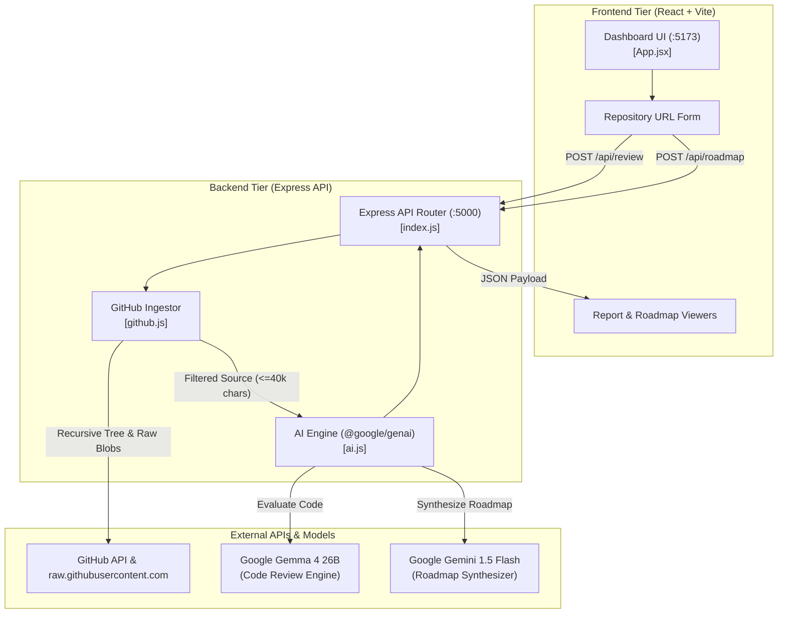

# ⚡ RepoPilot AI

> **Autonomous Code Review & Strategic Engineering Roadmaps powered by Google Gemma & Gemini**

[](https://nodejs.org/)
[](https://react.dev/)
[](https://vite.dev/)
[](https://www.npmjs.com/package/@google/genai)
[](https://opensource.org/licenses/MIT)

**RepoPilot AI** is an AI-powered developer intelligence platform that transforms public GitHub repositories into in-depth architectural reviews and actionable, prioritized technical roadmaps in seconds. 

By combining recursive Git tree exploration, intelligent source code ranking, and Google's next-generation AI models (**Gemma** and **Gemini**), RepoPilot AI gives engineering leads, open-source maintainers, and auditors instant clarity into any codebase.

---

## ✨ Key Features

- **🔍 Autonomous Code Reviews (Powered by Gemma)**:
  - High-level architecture and design pattern synthesis.
  - Identification of critical logic bugs, concurrency flaws, and security oversights.
  - Evidence-backed findings with direct file citations.
  - Actionable code recommendations and copy-paste refactoring snippets.
  - Recommended unit, integration, and regression test suites.

- **🗺️ Phased Technical Roadmaps (Powered by Gemini)**:
  - Automatically translates code review findings into an executive-level engineering roadmap.
  - **Phase 1**: Critical security patches, bug fixes, and stability hardening.
  - **Phase 2**: Test coverage expansion, developer ergonomics, and performance optimizations.
  - **Phase 3**: Architectural scaling, CI/CD pipelines, and feature expansion.
  - Measurable milestones and success metrics for sprints.

- **⚡ High-Throughput GitHub Analysis Engine**:
  - Recursive Git tree discovery (`git/trees/:branch?recursive=1`).
  - Context optimization: filters out noise (`node_modules`, `dist`, `.git`), sorts by priority (giving weight to `README`, `package.json`, and entrypoints), and analyzes up to the top 12 relevant files.
  - **Zero-Quota Raw Fetching**: Downloads file contents via `raw.githubusercontent.com` over CDN, preserving GitHub REST API limits.
  - **Rate-Limit Resilience**: Fallbacks to GitHub public web endpoints if unauthenticated quotas are exhausted.

- **🎨 Modern Developer Dashboard**:
  - Clean, dark-mode design tuned for engineering workflows.
  - Typography using **DM Sans** and **Space Grotesk**.
  - Accessible, semantic HTML5 with responsive layouts for mobile and desktop screens.
  - Dynamic loading states, interactive repo badges, and formatted report viewers.

---

## 🏛️ System Architecture



> 📖 **Deep-Dive Documentation**: See [`workflow/`](./workflow/) for complete Sequence Diagrams, Database Schemas, Entity-Relationship Models, and API Contracts.

---

## 🚀 Quick Start

### 1. Prerequisites
- **Node.js**: v18.0.0 or later (v20+ recommended)
- **npm**: v9.0.0 or later
- **Git**

### 2. Clone Repository
```bash
git clone https://github.com/SomnathSinha-oss/RepoPilot-AI.git
cd RepoPilot-AI
```

### 3. Install Dependencies
Install dependencies for root, backend, and frontend:
```bash
# Root dependencies (concurrently)
npm install

# Server dependencies (express, @google/genai, axios, etc.)
npm install --prefix server

# Client dependencies (react, vite)
npm install --prefix client --legacy-peer-deps
```

### 4. Configure Environment Variables
Copy `.env.example` into `server/.env`:
```bash
cp server/.env.example server/.env
```

Edit `server/.env`:
```env
PORT=5000

# Recommended: Add your free GitHub Personal Access Token to get 5,000 req/hr
GITHUB_TOKEN=your_github_token_here

# Get your free API key at https://aistudio.google.com/apikey
GEMINI_API_KEY=your_gemini_api_key_here

# Model configurations
GEMMA_MODEL=gemma-4-26b-a4b-it
GEMINI_MODEL=gemini-1.5-flash
```

*(Note: RepoPilot AI includes an intelligent local fallback analysis engine, allowing full offline testing even before adding API keys).*

### 5. Launch the Application
Run both the Express backend and the Vite frontend concurrently with a single command:
```bash
npm run dev
```

- **Frontend Application**: [http://localhost:5173/](http://localhost:5173/)
- **Backend API**: [http://localhost:5000/](http://localhost:5000/)
- **Health Check**: [http://localhost:5000/api/health](http://localhost:5000/api/health)

---

## 🔌 API Reference

### `GET /api/health`
Health check endpoint.
```json
{
  "status": "ok",
  "app": "RepoPilot AI"
}
```

### `POST /api/review`
Parses repository, downloads key files, and runs architectural code review with Gemma.
- **Request Body**:
  ```json
  {
    "url": "https://github.com/facebook/react"
  }
  ```
- **Response**:
  ```json
  {
    "repository": {
      "name": "react",
      "description": "The library for web and native user interfaces.",
      "language": "JavaScript",
      "stars": 230000,
      "default_branch": "main",
      "html_url": "https://github.com/facebook/react"
    },
    "files": [ ... ],
    "review": {
      "model": "gemma-4-26b-a4b-it",
      "report": "## Architecture Summary\n..."
    }
  }
  ```

### `POST /api/roadmap`
Executes code review and synthesizes a prioritized 3-phase technical roadmap with Gemini.
- **Request Body**:
  ```json
  {
    "url": "https://github.com/facebook/react"
  }
  ```
- **Response**:
  ```json
  {
    "repository": { ... },
    "review": { ... },
    "roadmap": {
      "model": "gemini-1.5-flash",
      "roadmap": "# Strategic Engineering Roadmap\n..."
    }
  }
  ```

---

## 📂 Project Structure

```text
RepoPilot AI/
├── client/                     # Vite + React Frontend
│   ├── public/                 # Static assets & icons
│   ├── src/
│   │   ├── App.jsx             # Main Dashboard UI & state management
│   │   ├── App.css             # Dashboard layout & dark theme styles
│   │   ├── index.css           # Global typography & resets (DM Sans)
│   │   └── main.jsx            # React root mount
│   ├── package.json            # Client dependencies
│   └── vite.config.js          # Vite config with backend API proxy (/api)
│
├── server/                     # Express Backend
│   ├── src/
│   │   ├── index.js            # Express server, routes & URL parser
│   │   ├── github.js           # GitHub API client, raw fetcher & cache
│   │   └── ai.js               # Google GenAI integration (Gemma & Gemini)
│   ├── .env.example            # Environment template
│   └── package.json            # Backend dependencies
│
├── workflow/                   # Architectural & Database Documentation
│   ├── README.md               # Workflow overview & system diagram
│   ├── architecture-flow.md    # Sequence diagrams & state machine
│   ├── database-schema.md      # PostgreSQL DDL & Redis caching specs
│   └── api-dataflow.md         # API contract & data pipeline docs
│
├── .gitignore                  # Git ignore rules (protects credentials)
├── .env.example                # Root environment template
├── package.json                # Root package for concurrent orchestration
└── README.md                   # Project documentation
```

---

## 🛠️ Tech Stack

| Category | Technology |
| :--- | :--- |
| **Frontend** | React 19, Vite 8, CSS3 (DM Sans, Space Grotesk) |
| **Backend** | Node.js (ESM), Express 4, Axios, Dotenv |
| **AI / ML** | Google Gen AI SDK (`@google/genai`), Google Gemma, Google Gemini |
| **APIs** | GitHub REST API v2022-11-28, raw.githubusercontent.com |
| **Tooling** | Concurrently, Nodemon |

---

## 🛡️ License

This project is licensed under the [MIT License](LICENSE).
