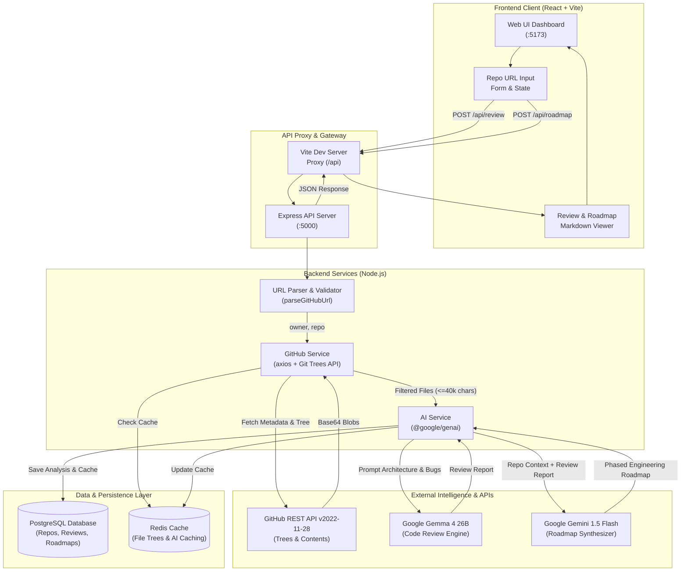

# RepoPilot AI - System Architecture & Workflow

Welcome to the architectural and operational documentation for **RepoPilot AI**. This directory contains the end-to-end specifications, workflow diagrams, database schema, and data pipeline designs for the application.

---

## Directory Navigation

| Document | Purpose |
| :--- | :--- |
| **[architecture-flow.md](./architecture-flow.md)** | End-to-end system architecture, sequence diagrams for Gemma review and Gemini roadmap, component interactions, and state machines. |
| **[database-schema.md](./database-schema.md)** | Relational database schema (PostgreSQL), Entity-Relationship (ER) diagram, caching strategy (Redis), and SQL migration scripts. |
| **[api-dataflow.md](./api-dataflow.md)** | API specifications, request/response contracts, data transformations, and error handling protocols. |

---

## High-Level System Workflow

The following flowchart illustrates how the Frontend, Backend, AI Models, and Database collaborate across the full user journey:

---

## Core System Responsibilities

### 1. Frontend Tier (`client/`)
- Single-page application bootstrapped with React 19 and Vite 8.
- Handles user input, state transitions (`idle`, `reviewing`, `roadmapping`, `error`), and real-time loading status.
- Renders repository statistics (stars, branch, primary language) and structured Markdown code reports.
- Communicates seamlessly with backend via Vite's proxy `/api` -> `http://localhost:5000`.

### 2. Backend Tier (`server/`)
- Express REST API operating in ESM (`"type": "module"`).
- Implements CORS, body limits, input sanitization, and GitHub URL normalization.
- Interacts with GitHub REST API:
  - Resolves default branch and pulls tree structure recursively.
  - Filters source extensions, suppresses generated/dependency folders, prioritizes root manifests and `README`.
  - Concurrently fetches top 12 source files and decodes base64 buffers.
- Interfaces with Google Gen AI SDK (`@google/genai`):
  - Formats source code within a 40,000-character context window.
  - Executes architecture & bug reviews via Gemma.
  - Translates reviews into phased engineering roadmaps via Gemini.

### 3. Database & Caching Tier (`workflow/database-schema.md`)
- Provides long-term persistence for repository metadata, generated reviews, and technical roadmaps.
- Eliminates redundant external API calls and expensive AI inference runs through SHA-based cache invalidation.
- Tracks audit telemetry, response latencies, and token consumption metrics.
