# API Specification & Data Pipeline

This document details the HTTP REST API endpoints, request/response contracts, data transformations, and error handling protocols for **RepoPilot AI**.

---

## 1. Data Pipeline Overview

The data pipeline standardizes input URLs, interacts with the GitHub API, digests source code within character budgets, and passes structured prompts to the Google Gen AI SDK:

```mermaid
flowchart LR
    In["User Raw Input\n(e.g., github.com/owner/repo)"] --> P1["URL Parser\n(Clean, Normalize, Extract owner/repo)"]
    P1 --> P2["GitHub Tree Collector\n(Filter extensions, Exclude dirs, Rank <=12 files)"]
    P2 --> P3["Base64 Decoder\n(Buffer -> UTF-8 source string)"]
    P3 --> P4["Context Formatter\n(Truncate <= 40,000 characters)"]
    P4 --> P5["Gemma Code Review Engine\n(Architecture, Bugs, Evidence, Fixes)"]
    P5 --> P6["Gemini Roadmap Engine\n(Phase 1, Phase 2, Phase 3, Milestones)"]
    P6 --> Out["JSON API Response\n(Rendered in React Dashboard)"]
```



---

## 2. API Endpoints

### 2.1 Health Check
- **Endpoint**: `GET /api/health`
- **Description**: Verifies the operational status of the Express API service.
- **Headers**: None required.
- **Response**: `200 OK`
```json
{
  "status": "ok",
  "app": "RepoPilot AI"
}
```

---

### 2.2 Repository Code Review
- **Endpoint**: `POST /api/review`
- **Description**: Ingests a GitHub repository URL, retrieves key source files, and produces an architectural and bug review via Gemma.
- **Request Body**:
```json
{
  "url": "https://github.com/facebook/react"
}
```

- **Successful Response**: `200 OK`
```json
{
  "repository": {
    "name": "react",
    "description": "The library for web and native user interfaces.",
    "language": "JavaScript",
    "stars": 225000,
    "default_branch": "main",
    "html_url": "https://github.com/facebook/react"
  },
  "files": [
    {
      "path": "README.md",
      "content": "# React\nReact is a JavaScript library...",
      "size": 1840
    },
    {
      "path": "package.json",
      "content": "{\n  \"name\": \"react-monorepo\"...\n}",
      "size": 2400
    }
  ],
  "review": {
    "model": "gemma-4-26b-a4b-it",
    "report": "## Architecture Summary\n\nReact follows a declarative component-driven architecture...\n\n## Bugs & Critical Issues\n\nNo critical memory leaks identified in evaluated blobs...\n\n## Findings with Evidence\n- `package.json`: Dependency pinning is strictly maintained...\n\n## Actionable Fixes\n1. Ensure devDependencies are pruned in production artifacts.\n\n## Testing Recommendations\n- Expand integration coverage for concurrent mode rendering."
  }
}
```

---

### 2.3 Strategic Engineering Roadmap
- **Endpoint**: `POST /api/roadmap`
- **Description**: Conducts an in-depth code review with Gemma and then synthesizes a prioritized multi-phase technical roadmap using Gemini.
- **Request Body**:
```json
{
  "url": "https://github.com/facebook/react"
}
```

- **Successful Response**: `200 OK`
```json
{
  "repository": {
    "name": "react",
    "description": "The library for web and native user interfaces.",
    "language": "JavaScript",
    "stars": 225000,
    "default_branch": "main",
    "html_url": "https://github.com/facebook/react"
  },
  "review": {
    "model": "gemma-4-26b-a4b-it",
    "report": "## Architecture Summary\n..."
  },
  "roadmap": {
    "model": "gemini-1.5-flash",
    "roadmap": "# Prioritized Engineering Roadmap\n\n### Phase 1: Critical Priorities & Stability (Months 1-2)\n- Security dependency upgrades and sanitization.\n- Resolution of high-priority lint warnings.\n\n### Phase 2: Performance & Test Modernization (Months 3-4)\n- Automated unit test coverage expansion to 85%.\n- CI pipeline build caching optimizations.\n\n### Phase 3: Architectural Scaling & Documentation (Months 5-6)\n- Server-driven UI telemetry integration.\n- Standardized developer onboarding tutorials."
  }
}
```

---

## 3. Error Handling Protocol

The API maps exceptions to standardized HTTP status codes:

| HTTP Status | Trigger Conditions | Error Response Structure |
| :--- | :--- | :--- |
| **400 Bad Request** | Missing `url` parameter, empty string, non-GitHub host, or missing owner/repo path. | `{"error": "GitHub URL must include both owner and repository name."}` |
| **502 Bad Gateway** | Upstream GitHub API rate-limited (403), repository not found (404), or Google GenAI model inference failure. | `{"error": "GitHub API error (404): Not Found"}` or `{"error": "AI Service error: ..."}` |
| **500 Internal Error** | Unhandled runtime exceptions or internal parser errors. | `{"error": "An unexpected error occurred."}` |

---

## 4. Security & Operational Guardrails

1. **Payload Limit**: JSON body parser is restricted to `20kb` via `express.json({ limit: '20kb' })` to prevent memory exhaustion attacks.
2. **CORS Restrictions**: `cors()` middleware ensures API calls can be consumed safely across trusted origins.
3. **Sensitive Data Redaction**: `.env` protects `GITHUB_TOKEN` and `GEMINI_API_KEY`. Git ignores ensure tokens are never checked into version control.
4. **Context Length Protection**: Incoming files are filtered (`<=20,000` bytes each, top 12 files maximum) and string truncated to `40,000` characters before being dispatched to the LLM context window.
