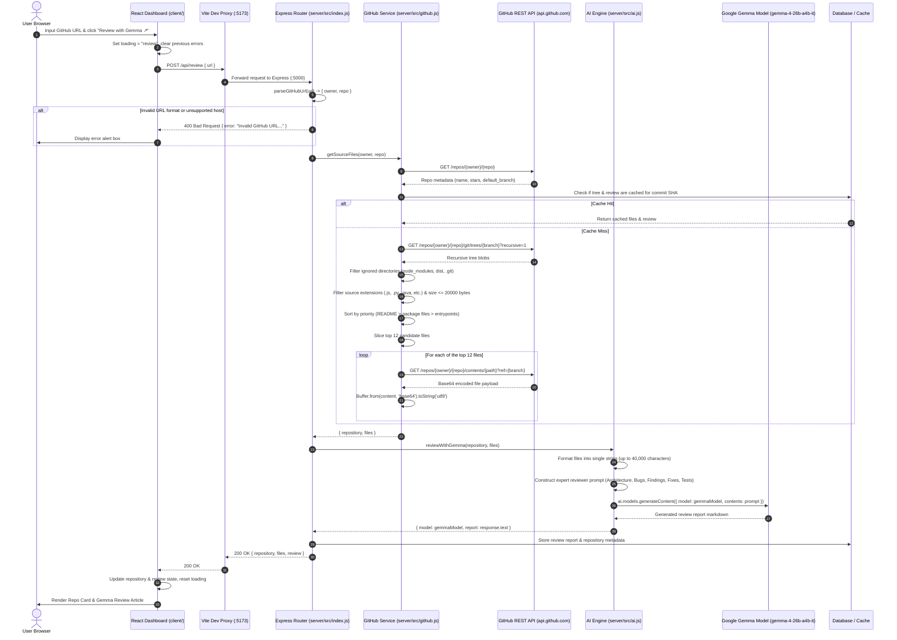
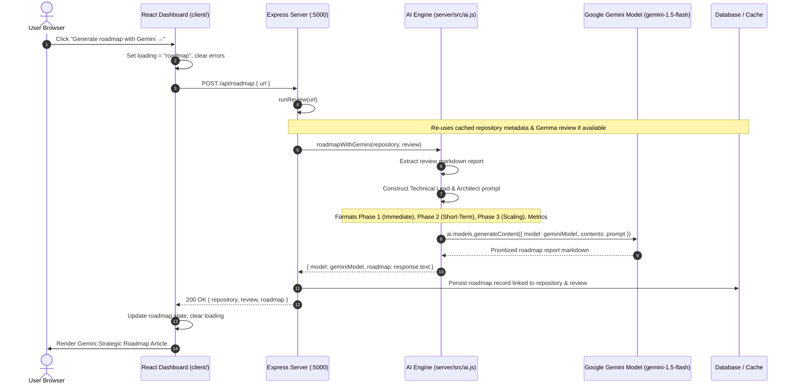
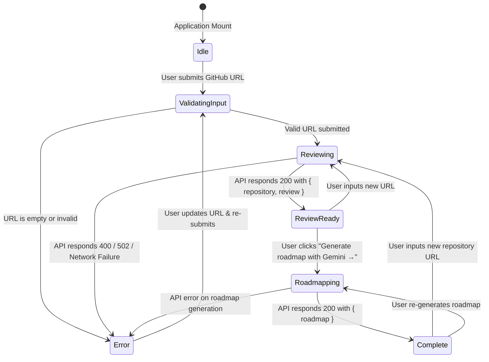
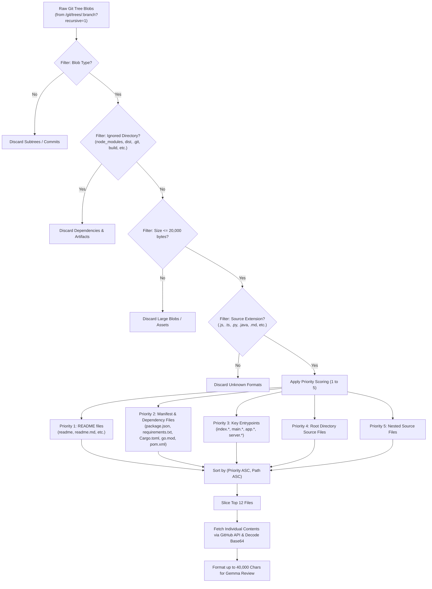

# Architecture & Execution Workflows

This document outlines the detailed execution workflows, message sequences, state transitions, and component interactions of **RepoPilot AI**.

---

## 1. Code Review Sequence Workflow (`POST /api/review`)

The diagram below traces the end-to-end flow from the user entering a GitHub repository URL through code evaluation by Google Gemma:

---

## 2. Strategic Roadmap Sequence Workflow (`POST /api/roadmap`)

When a user requests a strategic engineering roadmap, the backend leverages Google Gemini to synthesize the previous review findings into an actionable phased plan:

---

## 3. Frontend Dashboard State Machine

The client user interface manages deterministic state transitions across user actions and API responses:

---

## 4. File Ranking & Selection Pipeline

To optimize LLM context usage and ensure critical configuration/architecture files are analyzed first, `server/src/github.js` applies a multi-stage filtering and ranking algorithm:

