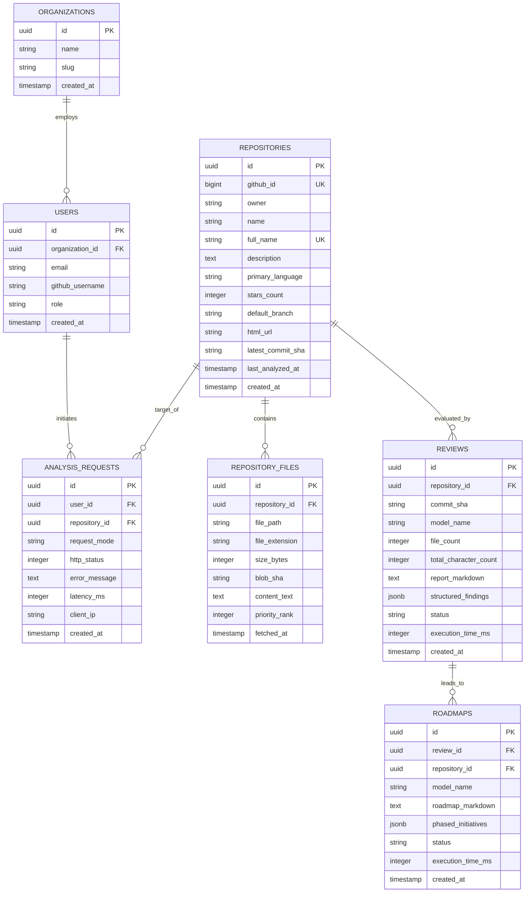

# Database Design & Persistence Layer

This document details the database architecture, entity models, schema definitions, and caching mechanisms for **RepoPilot AI**.

---

## 1. Storage Architecture Overview

While RepoPilot AI operates statelessly in development, production environments require a robust data persistence and caching tier to:
1. **Reduce GitHub API Rate Consumption**: GitHub enforces strict unauthenticated (60 req/hr) and authenticated (5,000 req/hr) rate limits.
2. **Minimize LLM Token Costs**: Repeated requests for the same repository commit can be served from cache instantly without invoking Gemma or Gemini inference.
3. **Audit & Historical Tracking**: Maintain audit trails of codebase evolution, architectural regressions, and roadmap completion over time.

### Recommended Stack
- **Primary Database**: **PostgreSQL 16+** (Relational integrity, JSONB support for raw ASTs/trees, and ACID transactions).
- **In-Memory Cache**: **Redis 7+** (Sub-millisecond retrieval of file trees, session states, and rate limiting buckets).

---

## 2. Entity-Relationship (ER) Diagram



---

## 3. Database Schema Definitions (PostgreSQL DDL)

Below are the production SQL migration scripts implementing the schema with primary keys, foreign constraints, and indexing:

```sql
-- Enable UUID extension
CREATE EXTENSION IF NOT EXISTS "uuid-ossp";

-- 1. Repositories Table
CREATE TABLE IF NOT EXISTS repositories (
    id UUID PRIMARY KEY DEFAULT uuid_generate_v4(),
    github_id BIGINT UNIQUE,
    owner VARCHAR(100) NOT NULL,
    name VARCHAR(100) NOT NULL,
    full_name VARCHAR(200) UNIQUE NOT NULL,
    description TEXT,
    primary_language VARCHAR(50),
    stars_count INTEGER DEFAULT 0,
    default_branch VARCHAR(100) DEFAULT 'main',
    html_url TEXT NOT NULL,
    latest_commit_sha VARCHAR(64),
    last_analyzed_at TIMESTAMP WITH TIME ZONE,
    created_at TIMESTAMP WITH TIME ZONE DEFAULT CURRENT_TIMESTAMP,
    updated_at TIMESTAMP WITH TIME ZONE DEFAULT CURRENT_TIMESTAMP
);

CREATE INDEX idx_repos_owner_name ON repositories(owner, name);
CREATE INDEX idx_repos_full_name ON repositories(full_name);

-- 2. Repository Files Table
CREATE TABLE IF NOT EXISTS repository_files (
    id UUID PRIMARY KEY DEFAULT uuid_generate_v4(),
    repository_id UUID NOT NULL REFERENCES repositories(id) ON DELETE CASCADE,
    file_path TEXT NOT NULL,
    file_extension VARCHAR(20),
    size_bytes INTEGER NOT NULL,
    blob_sha VARCHAR(64),
    content_text TEXT NOT NULL,
    priority_rank INTEGER DEFAULT 5,
    fetched_at TIMESTAMP WITH TIME ZONE DEFAULT CURRENT_TIMESTAMP,
    CONSTRAINT uq_repo_file_path UNIQUE (repository_id, file_path)
);

CREATE INDEX idx_repo_files_repo_id ON repository_files(repository_id);
CREATE INDEX idx_repo_files_ext ON repository_files(file_extension);

-- 3. Reviews Table
CREATE TABLE IF NOT EXISTS reviews (
    id UUID PRIMARY KEY DEFAULT uuid_generate_v4(),
    repository_id UUID NOT NULL REFERENCES repositories(id) ON DELETE CASCADE,
    commit_sha VARCHAR(64),
    model_name VARCHAR(100) NOT NULL,
    file_count INTEGER NOT NULL,
    total_character_count INTEGER NOT NULL,
    report_markdown TEXT NOT NULL,
    structured_findings JSONB,
    status VARCHAR(20) DEFAULT 'completed' CHECK (status IN ('pending', 'completed', 'failed')),
    execution_time_ms INTEGER,
    created_at TIMESTAMP WITH TIME ZONE DEFAULT CURRENT_TIMESTAMP
);

CREATE INDEX idx_reviews_repo_id ON reviews(repository_id);
CREATE INDEX idx_reviews_commit_sha ON reviews(commit_sha);
CREATE INDEX idx_reviews_created_at ON reviews(created_at DESC);

-- 4. Roadmaps Table
CREATE TABLE IF NOT EXISTS roadmaps (
    id UUID PRIMARY KEY DEFAULT uuid_generate_v4(),
    review_id UUID REFERENCES reviews(id) ON DELETE SET NULL,
    repository_id UUID NOT NULL REFERENCES repositories(id) ON DELETE CASCADE,
    model_name VARCHAR(100) NOT NULL,
    roadmap_markdown TEXT NOT NULL,
    phased_initiatives JSONB,
    status VARCHAR(20) DEFAULT 'completed' CHECK (status IN ('pending', 'completed', 'failed')),
    execution_time_ms INTEGER,
    created_at TIMESTAMP WITH TIME ZONE DEFAULT CURRENT_TIMESTAMP
);

CREATE INDEX idx_roadmaps_repo_id ON roadmaps(repository_id);
CREATE INDEX idx_roadmaps_review_id ON roadmaps(review_id);

-- 5. Audit & Telemetry Log Table
CREATE TABLE IF NOT EXISTS analysis_requests (
    id UUID PRIMARY KEY DEFAULT uuid_generate_v4(),
    repository_id UUID REFERENCES repositories(id) ON DELETE SET NULL,
    request_mode VARCHAR(20) NOT NULL CHECK (request_mode IN ('review', 'roadmap')),
    http_status INTEGER NOT NULL,
    error_message TEXT,
    latency_ms INTEGER NOT NULL,
    client_ip VARCHAR(45),
    created_at TIMESTAMP WITH TIME ZONE DEFAULT CURRENT_TIMESTAMP
);

CREATE INDEX idx_analysis_requests_created_at ON analysis_requests(created_at DESC);
```

---

## 4. In-Memory Caching Strategy (Redis)

To maximize performance, an in-memory key-value cache operates in front of PostgreSQL and the external APIs:

| Key Pattern | Data Structure | TTL | Purpose |
| :--- | :--- | :--- | :--- |
| `github:repo:{owner}:{repo}` | JSON String | 1 Hour | Caches GitHub metadata and default branch. |
| `github:tree:{owner}:{repo}:{sha}` | JSON Array | 24 Hours | Caches recursive tree blobs to prevent repeated tree traversal. |
| `ai:review:{owner}:{repo}:{sha}` | JSON String | 7 Days | Deduplicates Gemma code reviews for identical repository commits. |
| `ai:roadmap:{owner}:{repo}:{sha}` | JSON String | 7 Days | Deduplicates Gemini roadmap syntheses for identical reviews. |
| `ratelimit:{ip}` | Redis Counter | 1 Minute | Token-bucket rate limiting (e.g. max 10 analysis runs per minute). |

### Cache Invalidation Logic
1. When a user submits a GitHub URL, check if `github:repo:{owner}:{repo}` is cached.
2. Query the latest branch head SHA using `GET /repos/{owner}/{repo}/commits/{branch}` (conditional HTTP `If-None-Match` using ETag).
3. If the commit SHA matches `ai:review:{owner}:{repo}:{sha}`, serve the cached review instantaneously with `cache_hit: true`.
4. If a newer commit exists on the branch, invalidate previous cache keys and compute the fresh review.
